# win98se-themes

Windows 98 SE appearance schemes decoded into JSON, with one file per scheme. Includes all **33 schemes** from the supplied appearance-scheme registry export and a separately labeled **Windows Standard (default)** reconstruction using the built-in color table from the supplied Windows `USER.EXE`.

## Contents

- `themes/`: 34 standalone JSON files containing colors, font records, dimensions, header fields, source hashes, and complete binary payloads.
- [FORMAT.md](FORMAT.md): layout, byte ordering, and decoding caveats.

These are appearance schemes, including font-size variants, rather than complete desktop theme packages containing wallpapers, sounds, icons, or cursors. The collection comes from one installation; it is not a claim that these are every scheme shipped in every edition or configuration.

## Why two Windows Standard entries?

The exported **Windows Standard** scheme stores identical left and right title-bar colors: navy for active windows and gray for inactive windows. The supplied `USER.EXE` contains a contiguous 29-entry system-color table at file offset `0x635D2`, with these default endpoints:

| Title bar | Left | Right |
| --- | --- | --- |
| Active | `#000080` | `#1084D0` |
| Inactive | `#808080` | `#B5B5B5` |

**Windows Standard (default)** uses all 29 RGB values from that executable table, including `ButtonAlternateFace = #B4B4B4`. Its fonts, dimensions, header, and fourth color bytes are inherited from the exported Windows Standard scheme. It is a reconstruction, not an original exported registry value. Gradient enablement is a separate system setting.

## Provenance and fidelity

The source was a `REGEDIT4` export of `HKEY_CURRENT_USER\Control Panel\Appearance\Schemes`. The original scheme names and all 520 bytes per scheme are preserved in the JSON, including unknown fields and bytes after font-name terminators. Each file records source SHA-256 hashes. Font metrics retain their raw units; no pixel or point conversion is assumed.

The registry backup and Windows executable are not distributed here. Windows components and original theme data originate with Microsoft; this repository does not claim ownership of those components or grant a license to them. No project-wide license is assigned in this initial import.

The Windows 98 SE identification follows the supplied installation context; no precise OS build or executable version has been independently established.

## Preview gallery

Captured from the Windows 98 Appearance dialog at 800×600 through a native guest helper. Previews are unscaled crops of the original 800×600 captures in `captures/`. Large-font schemes retain the clipping and overlaps shown by the original Appearance preview.

| Scheme | Preview |
| --- | --- |
| [Brick](themes/brick.json) | 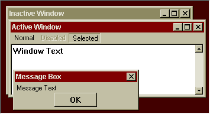 |
| [Desert](themes/desert.json) | 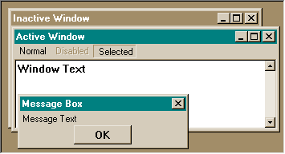 |
| [Eggplant](themes/eggplant.json) | 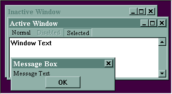 |
| [High Contrast #1 (extra large)](themes/high-contrast-1-extra-large.json) | 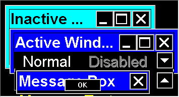 |
| [High Contrast #1 (large)](themes/high-contrast-1-large.json) | 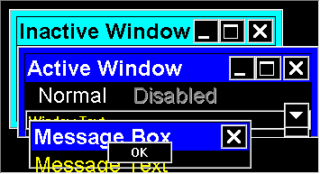 |
| [High Contrast #1](themes/high-contrast-1.json) | 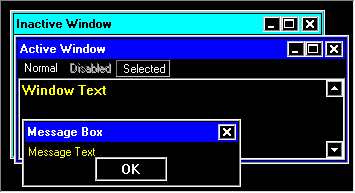 |
| [High Contrast #2 (extra large)](themes/high-contrast-2-extra-large.json) | 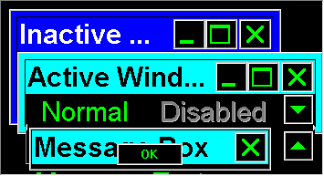 |
| [High Contrast #2 (large)](themes/high-contrast-2-large.json) | 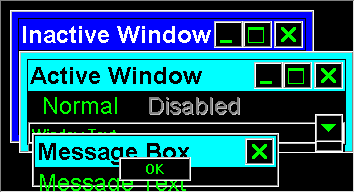 |
| [High Contrast #2](themes/high-contrast-2.json) | 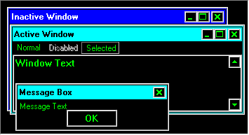 |
| [High Contrast Black (extra large)](themes/high-contrast-black-extra-large.json) | 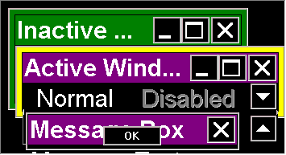 |
| [High Contrast Black (large)](themes/high-contrast-black-large.json) | 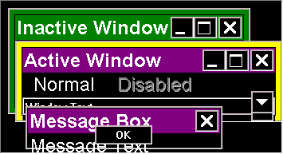 |
| [High Contrast Black](themes/high-contrast-black.json) | 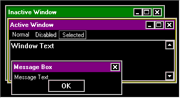 |
| [High Contrast White (extra large)](themes/high-contrast-white-extra-large.json) | 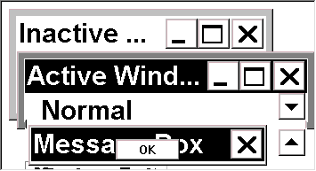 |
| [High Contrast White (large)](themes/high-contrast-white-large.json) | 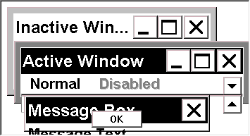 |
| [High Contrast White](themes/high-contrast-white.json) | 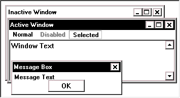 |
| [Lilac (large)](themes/lilac-large.json) | 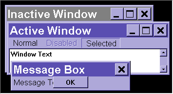 |
| [Lilac](themes/lilac.json) | 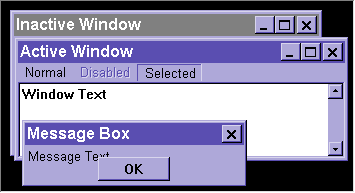 |
| [Maple](themes/maple.json) | 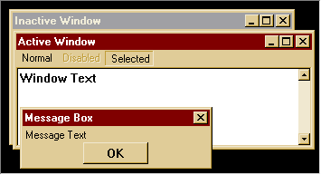 |
| [Marine (high color)](themes/marine-high-color.json) | 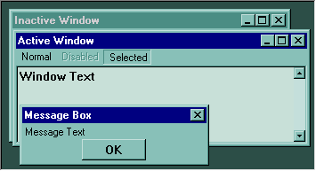 |
| [Plum (high color)](themes/plum-high-color.json) | 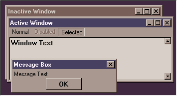 |
| [Pumpkin (large)](themes/pumpkin-large.json) | 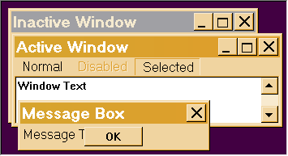 |
| [Rainy Day](themes/rainy-day.json) | 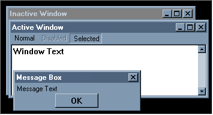 |
| [Red, White, and Blue (VGA)](themes/red-white-and-blue-vga.json) | 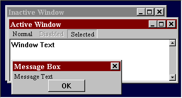 |
| [Rose (large)](themes/rose-large.json) | 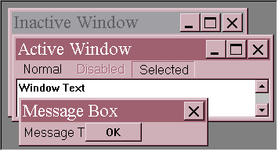 |
| [Rose](themes/rose.json) | 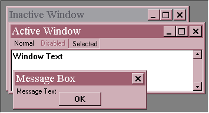 |
| [Slate](themes/slate.json) | 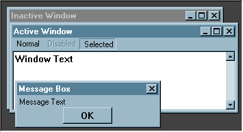 |
| [Spruce](themes/spruce.json) | 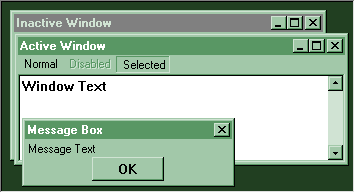 |
| [Storm (VGA)](themes/storm-vga.json) | 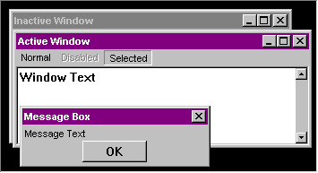 |
| [Teal (VGA)](themes/teal-vga.json) | 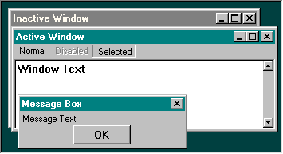 |
| [Wheat](themes/wheat.json) | 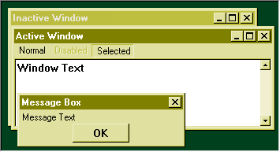 |
| [Windows Standard (default)](themes/windows-standard-default.json) | 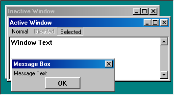 |
| [Windows Standard (extra large)](themes/windows-standard-extra-large.json) | 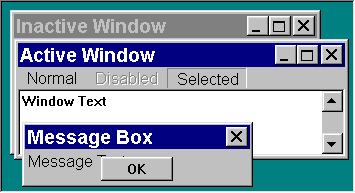 |
| [Windows Standard (large)](themes/windows-standard-large.json) | 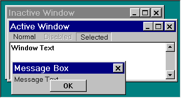 |
| [Windows Standard](themes/windows-standard.json) | 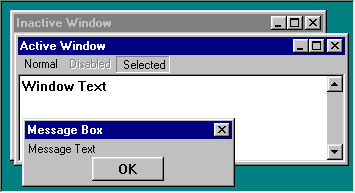 |

## Schemes

| Scheme | Source |
| --- | --- |
| [Brick](themes/brick.json) | Registry export |
| [Maple](themes/maple.json) | Registry export |
| [Spruce](themes/spruce.json) | Registry export |
| [Teal (VGA)](themes/teal-vga.json) | Registry export |
| [Red, White, and Blue (VGA)](themes/red-white-and-blue-vga.json) | Registry export |
| [Wheat](themes/wheat.json) | Registry export |
| [Pumpkin (large)](themes/pumpkin-large.json) | Registry export |
| [Eggplant](themes/eggplant.json) | Registry export |
| [Rainy Day](themes/rainy-day.json) | Registry export |
| [Desert](themes/desert.json) | Registry export |
| [Marine (high color)](themes/marine-high-color.json) | Registry export |
| [Windows Standard (extra large)](themes/windows-standard-extra-large.json) | Registry export |
| [Storm (VGA)](themes/storm-vga.json) | Registry export |
| [Windows Standard](themes/windows-standard.json) | Registry export |
| [Windows Standard (large)](themes/windows-standard-large.json) | Registry export |
| [Rose](themes/rose.json) | Registry export |
| [High Contrast Black (large)](themes/high-contrast-black-large.json) | Registry export |
| [High Contrast Black (extra large)](themes/high-contrast-black-extra-large.json) | Registry export |
| [High Contrast White (large)](themes/high-contrast-white-large.json) | Registry export |
| [High Contrast White (extra large)](themes/high-contrast-white-extra-large.json) | Registry export |
| [Rose (large)](themes/rose-large.json) | Registry export |
| [Lilac](themes/lilac.json) | Registry export |
| [Lilac (large)](themes/lilac-large.json) | Registry export |
| [Slate](themes/slate.json) | Registry export |
| [Plum (high color)](themes/plum-high-color.json) | Registry export |
| [High Contrast Black](themes/high-contrast-black.json) | Registry export |
| [High Contrast White](themes/high-contrast-white.json) | Registry export |
| [High Contrast #1](themes/high-contrast-1.json) | Registry export |
| [High Contrast #1 (large)](themes/high-contrast-1-large.json) | Registry export |
| [High Contrast #1 (extra large)](themes/high-contrast-1-extra-large.json) | Registry export |
| [High Contrast #2](themes/high-contrast-2.json) | Registry export |
| [High Contrast #2 (large)](themes/high-contrast-2-large.json) | Registry export |
| [High Contrast #2 (extra large)](themes/high-contrast-2-extra-large.json) | Registry export |
| [Windows Standard (default)](themes/windows-standard-default.json) | Reconstructed default |

## References

- [Microsoft: system-color indices and gradient endpoint meanings](https://learn.microsoft.com/en-us/windows/win32/api/winuser/nf-winuser-getsyscolor)
- [Microsoft: COLORREF byte ordering](https://learn.microsoft.com/en-us/windows/win32/gdi/colorref)
